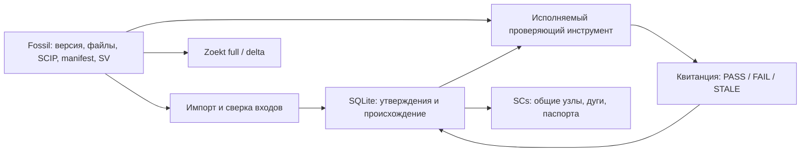

<!-- sv: evidence-graph 0.40, fossil-provenance 0.25, falsification 0.20, native-runtime 0.15 -->
# DAIS: граф утверждений и проверок

Первый исполняемый срез находится в `packages/dais-code-intelligence/`.
Два нативных Windows executable: `dais-ci.exe` для поиска Zoekt и
`dais-graph.exe` для версионного графа SCIP. Первичные исходники, индекс SCIP,
manifest входов и SV comment читаются из конкретного Fossil check-in.

CONFIRMED ✓ независимый compiled CLI oracle
`20261016T160358Z_3673c425`: 26 проверок, включая проигрывающие controls;
[отчёт и воспроизводители](../experiments_history/2026-10-16_dais-evidence-graph/REPORT.md).
Это функциональная проверка на небольшом синтетическом корпусе.

## Паспорт утверждения

Fact содержит subject/predicate/object, уникальный SHA256 ID, исходный protobuf
payload и origin: SHA256 индекса, protobuf address (`documents[i].occurrences[j]`),
путь документа и Fossil file artifact hash. Повторные вхождения сохраняют ordinals.
Полный global symbol сохраняет package version; `local 0` ограничен документом
и поколением индекса. Флаги SCIP relationships сохраняют собственное значение.

Snapshot связывает facts с repository namespace, full check-in UUID, исходным
SCIP, manifest, набором входов и SV. Отсутствующий SV представлен пустым значением.
Первичный SV comment не создаётся и не меняется импортёром.

Receipt содержит snapshot ID, target revision, input digest, имя predicate,
результат и SHA256 реально исполнявшегося проверяющего файла. Исторические квитанции
сохраняются. SCs header показывает текущий instrument hash для сопоставления;
применимость старой квитанции после смены инструмента требует новой проверки.
Хэши обеспечивают проверку целостности; криптографической подписи доверенного
внешнего исполнителя этот срез не создаёт.

## Область доказанного

Builtin predicate `projection_fidelity_ranges_declared_inputs_v1` проверяет:

- сохранённая проекция совпадает с исходным SCIP из Fossil;
- координаты находятся в границах привязанного UTF8-документа и не разрывают кодовую точку;
- полный заявленный набор workspace inputs совпадает с target revision;
- SCIP и manifest stamps соответствуют проверяемому снимку.

`semantic_status` остаётся `unknown`: правильность разрешения символов сторонним
indexer требует отдельного оракула. Manifest фиксирует заявленные входы, а факт
реального запуска стороннего indexer ещё должен подтверждаться capture pipeline.
JSON с надписью PASS не принимается через API как выполненная проверка.

Изменение зависимости делает применимость STALE даже при неизменном файле
occurrence. Изменённый cached fact вызывает FAIL. Оба результата сохраняются.
Повторный импорт идемпотентен; ошибочный импорт сохраняет прежний current;
historical snapshots остаются доступны. No-op check-in получает свой revision/SV.

## Формат и хранение

Таблицы `ci_graph_*` находятся в `metadata.sqlite` рядом с derived search metadata.
SCIP bytes кешируются с hash и адресом первичного Fossil artifact; их экспорт
проверен на byte identity. Новая независимая база первичных знаний не создаётся.
Потеря derived DB требует rebuild графа; сохранённые execution receipts нужно
восстановить из evidence archive. Автоматическая публикация receipts обратно в
Fossil относится к следующему срезу.

SCs export содержит общие entity nodes, именованные common arcs, классификацию
predicate, claim/provenance nodes и квитанции. JSON links несут подробные паспорта.
Экспорт имеет профиль DAIS; parser/engine compatibility с sc-machine пока Unknown.
Формат опирается на [официальный SCs level 1](https://ostis-ai.github.io/sc-machine/scs/scs/).

Первый профиль `dais-scip-utf8-v1` закреплён на SCIP
`e26a0b0fc83424dbfe6c703c0437d4703aec4aa0`. UTF16, неизвестные protobuf fields,
неподдержанные role bits и malformed input отклоняются до publication.
Полный call graph, межъязыковые Delphi/1С связи, производственный индексатор,
5 млн сущностей, p95/RSS и переключение MCP consumers остаются открытыми.

## Продолжение

Следующий срез: квалифицировать native SCIP producer на реальном проекте,
записывать входы и доказательство его запуска, затем подключить запросы графа
и ограниченный impact traversal к DAIS MCP. Основной маршрут остаётся в
[родительском плане](../plans/2026-10-16_zoekt-scip-fossil-sv.md).

Команды сборки и интерфейс: [README модуля](../packages/dais-code-intelligence/README.md).
