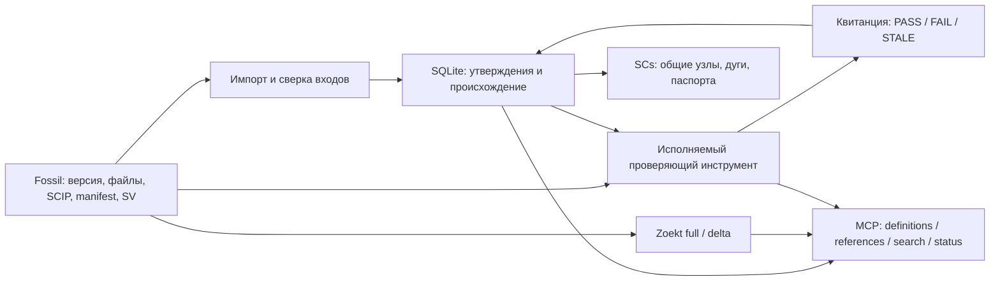

<!-- sv: evidence-graph 0.40, fossil-provenance 0.25, falsification 0.20, native-runtime 0.15 -->
# DAIS: граф утверждений и проверок

Первый исполняемый срез находится в `packages/dais-code-intelligence/`.
Четыре нативных Windows executable: `dais-ci.exe` для поиска Zoekt,
`dais-capture.exe` для запуска producer, `dais-graph.exe` для графа SCIP
и `dais-mcp.exe` для агентных запросов по stdio.
Первичные исходники, индекс SCIP,
manifest входов и SV comment читаются из конкретного Fossil check-in.

CONFIRMED ✓ независимый compiled CLI oracle
`20261016T160358Z_3673c425`: 26 проверок, включая проигрывающие controls;
[отчёт и воспроизводители](../experiments_history/2026-10-16_dais-evidence-graph/REPORT.md).
Это функциональная проверка на небольшом синтетическом корпусе.

## Паспорт утверждения

Fact содержит subject/predicate/object, уникальный SHA256 ID, исходный protobuf
payload и origin: SHA256 индекса, protobuf address (`documents[i].occurrences[j]`),
путь документа и Fossil file artifact hash. Повторные вхождения сохраняют ordinals.
Полный global symbol сохраняет package version; `local 0` ограничен документом
и поколением индекса. Флаги SCIP relationships сохраняют собственное значение.

Snapshot связывает facts с repository namespace, full check-in UUID, исходным
SCIP, manifest, набором входов и SV. Отсутствующий SV представлен пустым значением.
Первичный SV comment не создаётся и не меняется импортёром.

Receipt содержит snapshot ID, target revision, input digest, имя predicate,
результат и SHA256 реально исполнявшегося проверяющего файла. Исторические квитанции
сохраняются. SCs header показывает текущий instrument hash для сопоставления;
применимость старой квитанции после смены инструмента требует новой проверки.
Хэши обеспечивают проверку целостности; криптографической подписи доверенного
внешнего исполнителя этот срез не создаёт.

## Область доказанного

Builtin predicate `projection_fidelity_ranges_declared_inputs_v1` проверяет:

- сохранённая проекция совпадает с исходным SCIP из Fossil;
- координаты находятся в границах привязанного UTF8-документа и не разрывают кодовую точку;
- полный заявленный набор workspace inputs совпадает с target revision;
- SCIP и manifest stamps соответствуют проверяемому снимку.

`semantic_status` остаётся `unknown`: правильность разрешения символов сторонним
indexer требует отдельного оракула. Manifest фиксирует заявленные входы, а факт
реального запуска стороннего indexer фиксируется отдельной capture pipeline.
Сам graph verifier проверяет байты квитанции как manifest input; подлинность
внешнего автора квитанции и общую semantic correctness он не устанавливает.
JSON с надписью PASS не принимается через API как выполненная проверка.

Изменение зависимости делает применимость STALE даже при неизменном файле
occurrence. Изменённый cached fact вызывает FAIL. Оба результата сохраняются.
Повторный импорт идемпотентен; ошибочный импорт сохраняет прежний current;
historical snapshots остаются доступны. No-op check-in получает свой revision/SV.

## Формат и хранение

Таблицы `ci_graph_*` находятся в `metadata.sqlite` рядом с derived search metadata.
SCIP bytes кешируются с hash и адресом первичного Fossil artifact; их экспорт
проверен на byte identity. Новая независимая база первичных знаний не создаётся.
Потеря derived DB требует rebuild графа; сохранённые execution receipts нужно
восстановить из evidence archive. Автоматическая публикация receipts обратно в
Fossil относится к следующему срезу.

SCs export содержит общие entity nodes, именованные common arcs, классификацию
predicate, claim/provenance nodes и квитанции. JSON links несут подробные паспорта.
Экспорт имеет профиль DAIS; parser/engine compatibility с sc-machine пока Unknown.
Формат опирается на [официальный SCs level 1](https://ostis-ai.github.io/sc-machine/scs/scs/).

Первый профиль `dais-scip-utf8-v1` закреплён на SCIP
`e26a0b0fc83424dbfe6c703c0437d4703aec4aa0`. UTF16, неизвестные protobuf fields,
неподдержанные role bits и malformed input отклоняются до publication.
Полный call graph, межъязыковые Delphi/1С связи, языковое покрытие индексаторов,
5 млн сущностей, p95/RSS и переключение existing consumers остаются открытыми.

## Продолжение

CONFIRMED ✓ native producer/capture: независимый oracle
`20261017T055638Z_6cfebbbf` проверил 28 predicates на малом Go fixture: реальный
scip-go, golden definition/reference, byte coordinates после emoji, A→B ровно
три output files, raw roundtrip, retained failures и receipt-tamper STALE.
Современный `dais-scip-modern-utf8-v1` использует private descriptor schema v0.7.1;
legacy binding остаётся неизменным. Официальный scip-go v0.2.7 не объявляет
position_encoding; candidate-сборка DAIS задаёт его до сериализации, без правки
созданного индекса. Оригинальный неоднозначный индекс сохранён и отвергается.
[Отчёт, replay oracle и исходные отказы](../experiments_history/2026-10-17_dais-producer-capture/REPORT.md).

CONFIRMED ✓ повторный capture: `20261017T104937Z_76d2dc79` прошёл47 predicates
на реальном native producer. Изменение вызова Twice→Thrice в source C делает
старый graph STALE; новый bundle опубликован в fixture D, его graph PASS и
raw export побайтно совпадает. Подмена previous artifacts отвергается, старый
snapshot остаётся читаемым; обычный `ci/notes Ω.txt` не теряется среди входов.
`--previous-bundle-ref B` явно привязывает ровно три заменяемых artifacts к B,
а `--ref C` — актуальные исходники. Receipt хранит прямые hashes B; цепочка
прошлых запусков не обходится, третий повтор проверен. Это полный reindex,
structural capture evidence, без подписи или повышения semantic_status.
[Повторный replay и отказы](../experiments_history/2026-10-17_dais-repeated-capture/REPORT.md).

## Агентная навигация

MCP закрепляет repository, graph snapshot, applicability target и search generation
при запуске. `symboldefinition` и `symbolreferences` разрешают координаты через
полные SCIP identities; `codesearch` использует существующий Zoekt adapter,
`indexstatus` возвращает исполненную проверку. Перед каждым запросом повторно
сверяются declared inputs и cached projection. Смена search generation, STALE
inputs или повреждённые facts вызывают явный отказ. Исторический snapshot
доступен по его ID, без обхода цепочки родителей.

Navigation пока выполняет полный ограниченный проход facts. Выдача сохраняет
ambiguity/duplicates, origin и raw payload; входная усечённость вызывает отказ,
выходная обозначена total/returned/truncated. Coordinates: 0-based UTF8 bytes;
Zoekt line — 1-based. Result/frame bytes и request time ограничены. Store.Verify
сохраняет derived execution receipts; первичный Fossil не меняется.

CONFIRMED ✓ рабочий Go-корпус: 11 неизменных committed inputs, compiler-selected
Windows cohort из четырёх файлов. Независимый Go parser/types oracle нашёл
33 определения функций/методов и 67 typed references; raw SCIP comparison
`20261017T111122Z_7b16b13b` совпал без missing/extra associations. Внешний raw
stdio-клиент `20261017T200007Z_9253a529` прошёл 1270 проверок в двух процессах:
навигация по этим позициям, text search по исходным byte-lines, provenance,
отказы, limits и EOF. Общий semantic_status не повышен. Один ранний test отказ
не воспроизведён в трёх последовательных повторах и свежем 10-package прогоне;
исходная ошибка и границы вывода сохранены в
[отчёте и воспроизводителях](../experiments_history/2026-10-17_dais-navigation-mcp/REPORT.md).

Следующий срез: квалификация consumer cutover и ограниченный impact traversal;
автоматическая публикация и incremental execution ещё открыты.
Полнота внешних чтений producer, межъязыковая семантика и длительно работающий
installed service пока не квалифицированы. Основной маршрут остаётся в
[родительском плане](../plans/2026-10-16_zoekt-scip-fossil-sv.md).

Команды сборки и интерфейс: [README модуля](../packages/dais-code-intelligence/README.md).
