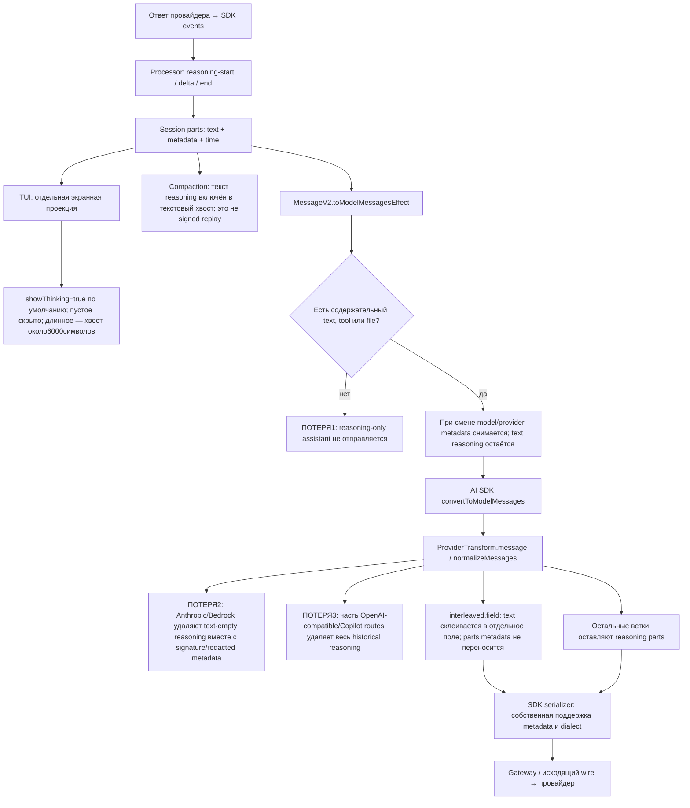

# Путь reasoning по умолчанию

Срез текущего исходника 2026-10-16, до исправления потери signed-empty reasoning. Статус правил ниже — **Inferred по коду**; это не результат запуска всех provider routes. Хэши исходников и line anchors: [evidence](../experiments_history/2026-10-16_haiku-omp-compare/default-flow-evidence.json).

```yaml
Keywords: reasoning-flow 0.40, replay-loss 0.30, route-policy 0.20, display-boundary 0.10
Semantic dominant: Показать разные операции над reasoning от получения до следующего исходящего запроса.
md5: a174f20e893d4cb680e7529f36ba0d81
prev-md5: 00000000000000000000000000000000
parent-goal-md5: 81e70d3af5c64b8292d15e6f370a49bc
```



Это обзор точек изменения, а не взаимоисключающие маршруты. Условия `ProviderTransform` последовательны и могут сочетаться: например, Bedrock сначала удаляет пустые parts, а затем при заданном interleaved.field перекодирует оставшиеся. Ранние return отдельно названы в таблице. UI не редактирует сохранённый reasoning.

## Вход и сохранение

- `session/processor.ts:883–902`: start создаёт пустой reasoning part и сохраняет initial providerMetadata.
- `:905–928`: delta добавляет text; поступившая providerMetadata заменяет metadata part. Delta с неизвестным id отбрасывается с warning.
- `:839–850`: end сохраняет полный builder text, final metadata и время. Пустой text учитывается в счётчике, но здесь part не удаляется.
- Незавершённые reasoning parts финализируются отдельным `finalizeReasoning`; сам этот helper не сокращает text.

## Подготовка истории до provider transform

- `session/message-v2.ts:1509`: при несовпадении `providerID/modelID` предыдущего assistant и выбранной модели используется `differentModel`.
- `:1728–1743`: reasoning добавляется в assistant parts; при `differentModel` его metadata не добавляется. Поэтому сохранение текста ещё не означает сохранение непрозрачной подписи.
- `:1533–1548`, `:1745–1756`: `delivered` устанавливается от содержательного text, tool или file, но не от reasoning. Assistant только с reasoning не попадает в replay, даже если reasoning непустой или подписанный.
- `:1778–1790`: такой drop называется `empty delivery` и логируется; исходные DB parts не удаляются этим участком.
- Затем UIMessage преобразуется AI SDK в ModelMessage. В `session/llm.ts` middleware перед отправкой вызывает `ProviderTransform.message`.

## Маршрутная политика normalizeMessages

Условия выполняются последовательно. `_options` этой функции не читается: общего request-переключателя «сохранить reasoning» в ней нет.

| Условие | Что делает код | `provider/transform.ts` |
|---|---|---|
| npm=`@ai-sdk/anthropic` | Удаляет empty text **и empty reasoning**, не учитывая metadata; удаляет опустевший message |79–104|
| npm=`@ai-sdk/amazon-bedrock` | Такая же фильтрация |108–133|
| npm=`@ai-sdk/google-vertex/anthropic` | Первый empty-filter его не затрагивает; ниже non-tool части могут перемещаться перед tool calls |164–187|
| Mistral/provider либо id содержит mistral/devstral | Нормализует tool IDs/sequence, возвращается раньше следующих веток; reasoning не режет |189–236|
| DeepSeek/MiMo, кроме OpenRouter SDK | Сохраняет имеющийся reasoning; отсутствующий заменяет empty reasoning part |251–278|
| `capabilities.interleaved.field` задан, SDK не OpenRouter/DeepSeek/Anthropic/Vertex Anthropic | Склеивает reasoning text без разделителя, удаляет parts и пишет строку в `openaiCompatible[field]`; metadata этих parts не переносится; ранний return |281–315|
| npm=openai-compatible или github-copilot, кроме исключений | Удаляет **весь** reasoning в assistant; также message-level reasoning_content/reasoning_details |333–369|
| Исключения предыдущей строки | Copilot SDK с `/github/i` в URL; либо lower-case model API id содержит deepseek/mimo |335–339|
| Остальные SDK | Эта функция оставляет reasoning parts; последующий SDK может иметь собственную политику |339–372|

После нормализации считаются reasoning census, применяются маршрутные cache markers и remap namespace `providerOptions` на message/part level (`:439–495`). Это не восстановление уже удалённых blocks.

## SDK — ещё одна граница

По прочитанному установленному SDK: Anthropic4.0.57 отправляет thinking с `anthropic.signature` или redactedData; unsupported reasoning без такой metadata пропускает с warning. Bedrock5.0.87 читает amazonBedrock/bedrock signature, redactedContent и redactedData; неподдерживаемый reasoning в этой ветке пропускает без warning. Это source-level граница, не live API acceptance.

Таким образом, «part остался в памяти», «text перемещён в другое поле» и «блок с подписью действительно ушёл на wire» — разные проверяемые состояния.

## Экран, compaction, checkpoint

- TUI declared default `thinking_visibility=true`; persisted значение может его переопределить. Пустое после удаления `[REDACTED]`/trim скрывается. `THINKING_DISPLAY_MAX=6000`; завершённый блок показывает последние6000символов, streaming окно квантовано по1024. Это только отрисовка, с omitted counter.
- `compaction.messageText` и `tailMessageText` включают reasoning text. Recent-tail выбирает целые сообщения с заявленным бюджетом32768tokens. Это текстовое представление: оно не доказывает сохранение signature/account/prefix binding и не равно исходным thinking blocks. Полный compact→storage→wire в этом аудите не квалифицирован.
- Checkpoint хранит уже подготовленные ModelMessage[] и берёт их prefix slice. В проверенных prefix helpers отдельного reasoning-filter нет; потери, случившиеся до сохранения checkpoint, это не исправляет.

## Подтверждённый остаток

На Haiku выявлены потеря signed-empty reasoning в transform и отсутствие reasoning на ранее сохранённом wire. Отдельно текущий код допускает reasoning-only drop и metadata drop при смене модели. Их фактическая частота и latency effect не измерены этим графом. Для исправления нужен baseline/регрессия на каждом изменяемом слое; изменение одного фильтра не закрывает всю цепь.

Исходники продукта в ходе построения графа не менялись. Исследование [остаётся открытым](../plans/2026-10-16_haiku-omp-controlled-latency.md).
