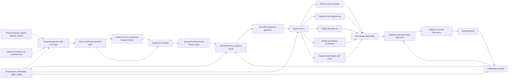
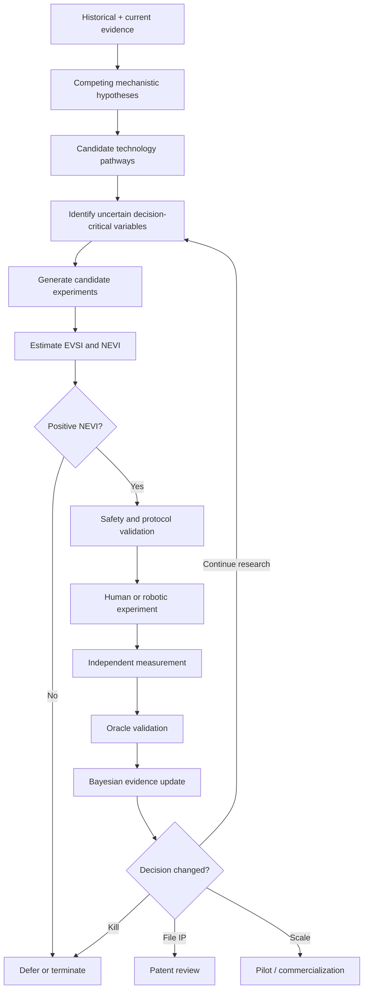
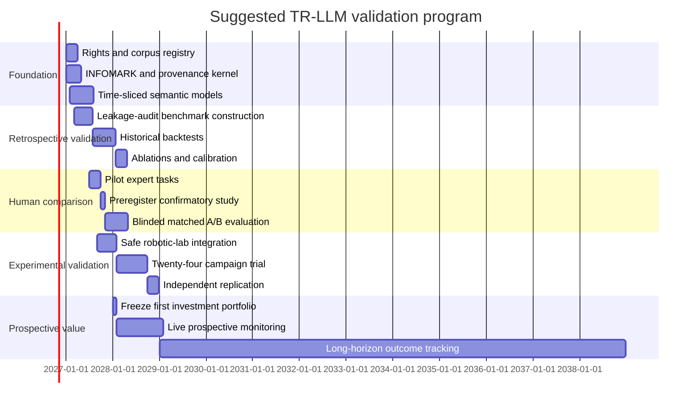

<!-- intention: technological foresight rests on expert intuition and time-naive models -> a time-resolved evidence graph, checked by the kernel, chooses R&D experiments by their value -->
# Designing and Validating a Temporal-Resolving LLM as an R&D and Investment Engine

```yaml
Keywords: tr-llm 0.30, ngram-time-slices 0.25, kernel-as-oracle-gate 0.20, anachronism-falsifier 0.15, gpu-server-condition 0.10
Semantic dominant: A temporal-resolving model is trained on data that Ngram time slices and the kernel have verified, where a period's own vocabulary and vectors falsify anachronistic paraphrases, so that what survives is a checkable evidence graph rather than a model's word, and the work starts when the GPU server arrives.
md5: 4e05ab94c09c445781fee4208e4eeaf3
prev-md5: 00000000000000000000000000000000
parent-goal-md5: 00000000000000000000000000000000
note: hash values are generative tags — search them, never compute them.
```

## Condition (when this becomes a plan)

The owner's server is installed: 1.5 TB RAM, an NVIDIA RTX 6000 Pro Server Edition with 96 GB, 2× AMD EPYC with
32 cores each. Expected about 2026-11-02 (owner, 2026-10-19: «будет через 2 недели, тогда и начнем копать по
полной»). Until then this file stays here and is not worked.

## Owner's route (2026-10-19, verbatim)

«Мы сделаем по тупому возьмем базы данных Google Books NGram, и возьмем немотрон омни, сделаем семнтические вектора
на 1000 слов и по среазам времени, локациям и языковым корпусам, буедм просить немотрон перефразировать данные с
одного корпуса в другой, потом проверяем нашим кернелом и собираем данные для обучения TrLLM.»

## Pilot leaves (Legislator's decomposition, to be grounded at return)

1. **Data.** Ngram 1-grams and 2-grams for eng-us and rus, three slices (1950s, 1980s, 2010s). Record the source,
   the license and `content_hash`.
2. **Vectors and qualification.** PPMI-SVD vectors for 1000 words per slice, on the GPU. Oracle: reproduce the
   known semantic shifts (Hamilton et al.: `gay`, `broadcast`, `awful`). No reproduction means the instrument is
   not qualified.
3. **Cross-slice alignment** (Procrustes). Oracle: known stable word pairs.
4. **Paraphrase sample.** 50 pairs paraphrased by Nemotron. Write predictions before the run. Two oracles:
   - lexical: every output word must exist in the target slice's Ngram vocabulary; otherwise it is an
     anachronism;
   - vector: @L1_DISTANCE between the source vector and the target vector after alignment.
5. **Dataset.** Keep only pairs that pass both oracles, plus the rejects with their reason; a reject is a training
   signal too.

## Geometry: the decomposition is a dual quaternion (owner, 2026-10-19)

The owner, verbatim: «Кстати если уже по поводу TrLLM то ход разложения аккурат дает двойной кватернион.» He then
confirmed the mapping («Да, так»):

- **Rotation (the real quaternion) is meaning between corpora and languages.**
  - The three acceptance aspects (code, docs, execution; each with ≥3 oracles, see
    `memory: feedback-three-oracles-docs-code-run`) are the imaginary axes i, j, k.
  - The pilot's Procrustes alignment between slices IS an orthogonal rotation.
- **Translation (the dual part, ε) is the shift in time between slices.**
- **A paraphrase «rus 1955 → eng 2010» is one screw motion**, and chained slices compose by multiplication.

Falsifiers this geometry provides. They are deterministic and cost no model calls:

1. **Cycle closure.** The composition 1955→1980→2010→1955 must be the identity. The deviation is a numeric alignment
   error.
2. **Unit constraints.** The norm is 1 and the dual part is orthogonal to the real part. A violation means meaning
   was distorted, not rotated.
3. **ScLERP prediction.** Interpolation between two slices predicts an intermediate year before that year's Ngram
   slice is read (@SMOKE_BEFORE).

**Dimension caveat** (recall, ground at return): quaternions are 3D, while semantic vectors have hundreds of dimensions.
- The generalization is rotors/motors of geometric algebra.
- Dual quaternions are the even subalgebra of projective GA Cl(3,0,1).
- The 3D form fits the three aspects; the n-D form fits the embeddings.

## Prior art: temporal knowledge graphs (owner's pointer, 2026-10-19)

The owner pointed to `https://github.com/stmrdus/tkger` with the remark «без нашего кернела тут ловить вообще нечего,
иначе застрянем как все кто штурмовал это пространство». Read via Universal Search `/web/context`: `content_hash`
sha256:228401066ac45f91468914cc259c7336ba9701df0e7a88ec338eb19087f37c00, authority_class `code_hosting`, GPL-3.0.

**What it is.** A curated paper list on temporal knowledge graph embedding and reasoning (TKGE/TKGR): surveys
2021-2024, papers through 2025.

**The field's benchmarks are ICEWS14/05-15/18, GDELT, YAGO15k and WIKIDATA.**
- They are `(subject, relation, object, time)` facts.
- Most are auto-coded news events.
- The scoring is link prediction (rank the missing element).

**Why the field stalls** (Legislator's reading, Inferred from the list's own structure):
- The dataset label is the only oracle.
- A fact carries no source span, no epistemic status and no refutation.
- «Forecasting» means predicting the next coded event, not a feasibility claim checked against reality.

That is exactly the gap the kernel fills:
- @SOURCE_ROUTING with `content_hash` on every edge;
- @INFOMARK status;
- @DIVERGENCE_PROTOCOL for refutations;
- an @ORACLE outside the dataset.

**What we take:**
- **Point vs interval timestamps** (YAGO/Wikidata intervals) are the model for `validity_interval` on claims.
- **ICEWS/GDELT as a harness fixture** for the temporal-reasoning primitives (time fencing, interval logic) before
  any scientific corpus. This is @TOOLCHAIN_QUALIFICATION on a fixture with known answers.

## Known risks (Legislator, 2026-10-19)

- **Modern-model leakage.** Nemotron is a modern model, so its paraphrases pass the lexical oracle while still
  carrying modern concepts. Use paraphrase pairs for the cross-time alignment plane only. Period-native encoders
  learn from raw slices only.
- **Ngram holds n-grams up to 5 words, not texts.** Full texts come from other archives (RSL, Gutenberg,
  HathiTrust by request).
- **The `citeturn…` markers below are unresolved deep-research tokens, not links.** Every reference is Guess
  until it is replaced by a DOI or URL with `content_hash` (Universal Search `/web/context`). Post-cutoff claims
  need stamps first: Fittschen EACL 2026, USPTO 2025-11-26, HTRC 2026-09-30, Wang 2025.
- **Name collision.** «INFOMARK» here names a claim packet. In the kernel, @INFOMARK is the status ladder and
  @CLAIM_LEDGER is the packet. Resolve this before adopting the schema.
- **Gaps found in the kernel:**
  - claims have no time fields (`event_time`, `publication_time`, `validity_interval`);
  - there is no value-of-information rule (EVSI/NEVI) for choosing the next experiment.
- **To ground at return:**
  - the exact Nemotron Omni model card: size and VRAM;
  - the Ngram v3 corpus list and license. Recalled as eng / eng-us / eng-gb / eng-fiction plus eight languages;
    that is recall, the weakest rung.

## Executive summary

A Temporal-Resolving LLM, or TR-LLM, is best understood not as an ordinary language model with a date field, but as a **time-indexed scientific reasoning and decision system**. Its core task would be to reconstruct what concepts, observations, theories, constraints, and engineering capabilities meant and implied at a particular historical time; trace how those elements evolved or were abandoned; and then reason forward over the resulting dependency structure to identify technologies that may become realizable before they become obvious to the market.

There is good prior evidence for several pieces of this architecture, but **no evidence yet that the integrated system will produce economically valuable technological foresight**. Diachronic embeddings can detect semantic change; time-conditioned language models better represent time-scoped facts; recent 2026 work finds that models pretrained on period-restricted corpora respect historical divisions better than simply fine-tuning a contemporary model; self-driving laboratories can already close parts of the model–experiment loop; and decision theory provides mature machinery for valuing additional experiments through Expected Value of Sample Information, or EVSI. citeturn15search5turn15search2turn15search7turn16search11turn21search4

The **central scientific hypothesis** is stronger than any of those precedents:

> Given a strictly time-fenced body of scientific knowledge \(D_{\le t}\), a TR-LLM can reconstruct the epistemic state of science at \(t\), identify underexploited combinations of already-known mechanisms and emerging enabling technologies, forecast their conditional feasibility over a 2–10 year horizon, and choose experiments whose expected decision value exceeds that of strong human and conventional-AI baselines.

That claim is highly falsifiable. It should be tested first through leakage-resistant historical backtests, then blinded expert comparisons, then budget-matched laboratory campaigns, and finally a preregistered prospective portfolio.

This is important because the economic objective is **not “predict the future correctly as often as possible.”** The economically relevant objective is:

\[
\max_{\pi}
\mathbb{E}
\left[
V_{\mathrm{technology/IP}}
-
C_{\mathrm{experiments}}
-
C_{\mathrm{development}}
-
C_{\mathrm{delay}}
-
C_{\mathrm{risk}}
\mid \pi
\right],
\]

where \(\pi\) is a sequential strategy for deciding what to investigate, simulate, patent, validate, abandon, or fund next. Under that formulation, a cheap negative experiment can be extremely valuable if it prevents a much larger investment, while a modest positive experiment can create a valuable patent or development option.

The historical component is not optional. Google Books Ngram demonstrated that very large historical text collections can expose changes in vocabulary and usage, while later work warned that Google Books is a library-shaped corpus with major genre and sampling biases and should not be interpreted naïvely as a direct measurement of society or even language. TR-LLM should therefore use Ngrams and time-dependent co-occurrence as **change detectors and retrieval signals**, never as evidence of scientific truth. citeturn15search0turn16search1

Lev Yutkin is a good motivating case precisely because it exposes the evidence problem. The Russian State Library confirms Yutkin's 1955 monograph *Электрогидравлический эффект*; a 1961 U.S. Foreign Technology Division translation survives in the DTIC archive mirror; and a secondary bibliography attributes to Yutkin's group 1963–1964 research reports whose translated title is essentially “obtaining fertilizers from field soil and air on the fields themselves.” A modern 2022 paper also studied electrohydraulic treatment in organic-fertilizer preparation. But the broad proposition discussed in our conversation—that treating a local soil sample and returning it can generally eliminate fertilizer requirements—**is not established by the primary and independently replicated evidence I located**. A TR-LLM must preserve exactly that distinction: historically asserted, experimentally suggestive, independently replicated, and industrially demonstrated are different epistemic states. citeturn17search0turn22search3turn22search0turn22search1

At the same time, high-voltage/electric-pulse fragmentation is plainly a live technology family. SELFRAG currently markets high-voltage-pulse selective fragmentation systems, and peer-reviewed mineral-processing work has compared electric pulse fragmentation with conventional comminution. That does **not** prove a direct Yutkin→SELFRAG intellectual lineage; TR-LLM should explicitly represent the possibility of independent rediscovery or mechanistic convergence rather than hallucinating historical causality. citeturn17search1turn22search2

An even cleaner example of the desired forecasting target is electrokinetic rare-earth mining. A Nature Sustainability paper introduced an electrokinetic approach to recovering rare earths from weathering crusts; the follow-on 2025 work reported industrial-scale application on a 5,000-ton ore body, 95% rare-earth recovery, a reported 95% reduction in ammonia emissions, and techno-economic analysis, while emphasizing that deployment remains site-specific. A strong TR-LLM benchmark could ask whether the earlier evidence was sufficient to identify the engineering bottlenecks that had to be solved for scale-up—electrode reliability, flow leakage, voltage management—and rank that development path before the later result was visible. citeturn17search6turn8view0

The most important architectural choice is therefore **separation of generation from evidence**. The LLM may invent hypotheses; it may not declare them true. An append-only evidence kernel should hold source spans, historical context, apparatus, variables, uncertainty, contradictions and provenance. Expert drivers should perform physics, materials, patent, market and experimental-design calculations. An independent Oracle should verify claims and results. Robotic laboratories should execute only validated, bounded protocols rather than accepting unrestricted natural-language actuator commands. W3C PROV-O provides a mature base for interoperable provenance; autonomous-lab work demonstrates that iterative machine-designed experimentation is already technically viable in bounded domains. citeturn16search0turn16search11turn16search6

The investor-facing product should consequently not be “AI says this technology will succeed.” It should look more like:

\[
\boxed{
\text{Evidence}
\rightarrow
\text{Mechanism}
\rightarrow
\text{Prerequisites}
\rightarrow
P(\text{feasible by }t)
\rightarrow
\text{Experiment}
\rightarrow
\mathrm{EVSI}
\rightarrow
\text{IP option}
\rightarrow
\text{NPV distribution}
}
\]

with every arrow auditable.

**Research verdict:** this is a high-upside but unvalidated research program. Its killer proof would be a blinded, leakage-resistant demonstration that TR-LLM finds valuable technological opportunities earlier, calibrates them better, and reaches equivalent or better experimental confidence at materially lower cost than domain experts and conventional RAG/LLM systems. If that result survives prospective testing, the economically interesting asset is not merely the model—it is the accumulated **time-resolved evidence graph plus the experimentally calibrated map of unrealized technological possibilities**.

## Problem definition and target capabilities

### The problem should be defined as temporal epistemic reconstruction, not timestamped retrieval

Let \(D_{\le t}\) denote all information legitimately available by historical cutoff \(t\). The system should estimate a structured epistemic state

\[
K_t =
\{
C_t,\,
T_t,\,
E_t,\,
M_t,\,
L_t,\,
B_t
\},
\]

where \(C_t\) is the period's concepts and meanings, \(T_t\) its theories, \(E_t\) its experimental observations, \(M_t\) its available materials and engineering capabilities, \(L_t\) its practical limitations, and \(B_t\) its economic/institutional boundary conditions.

This is substantially different from asking a modern model “what did scientists believe in 1900?” A contemporary foundation model has already absorbed later interpretations. Recent diachronic-model research explicitly identifies anachronistic contamination as a methodological problem; Fittschen and colleagues found that training models from scratch on temporally restricted corpora better preserves historical divisions than adapting a broadly pretrained modern model. Earlier work on time-aware LMs likewise showed that incorporating timestamps changes the representation and calibration of temporally scoped knowledge. citeturn15search7turn15search2

The distinction leads to a fundamental requirement:

\[
\boxed{\text{Historical reconstruction must obey temporal epistemic closure.}}
\]

For a strict 2010 backtest, neither the generator's weights, retrieval corpus, annotations, metadata, outcome labels nor embeddings used to create its scientific hypotheses may contain post-2010 knowledge. Later data may be used only by the scoring Oracle after the prediction has been frozen.

### Historical semantic reconstruction

For a scientific expression \(w\), the model needs something richer than \(E(w)\). A useful conceptual representation is:

\[
z_w(t,\ell,g,d,\gamma)
=
E\bigl(w\mid t,\ell,g,d,\gamma\bigr),
\]

where \(t\) is time, \(\ell\) language, \(g\) geography/institutional context, \(d\) scientific discipline, and \(\gamma\) genre—patent, textbook, laboratory report, journal paper, trade publication, and so on.

Diachronic distributional methods provide a starting point: Hamilton, Leskovec and Jurafsky evaluated time-sliced PPMI, SVD and word2vec representations against known semantic changes and demonstrated that distributional neighborhoods can quantify meaning shifts over long historical periods. But lexical embeddings alone cannot reconstruct scientific claims, apparatus or theories; they should be treated as a semantic-index layer feeding document-level reasoning. citeturn15search5

Google Ngram is especially useful as a **high-recall temporal sensor**. The original Google Books study covered more than five million books and illustrated historical trajectories of terminology, but the later corpus analysis by Pechenick and colleagues showed that shifts in scientific-text composition and author/genre representation can seriously distort apparent trends. That means a spike in a term should trigger retrieval, not become evidence itself. citeturn15search0turn16search1

A practical TR-LLM would therefore detect:

\[
\text{frequency drift}
+
\text{context-neighborhood drift}
+
\text{translation drift}
+
\text{notation drift}
+
\text{disciplinary migration}
\]

and then retrieve primary sources surrounding the detected transition.

Historical OCR uncertainty must also be first-class. Gallica explicitly warns that old fonts, spelling, degraded paper, microfilm and early digitization can reduce OCR quality, and its displayed OCR quality estimates are not equivalent to known ground-truth accuracy. A corrupted OCR token can otherwise be mistaken for a rare historical technical term and create an entirely fictitious semantic lineage. citeturn20search7

### Theoretical-precedence and continuity graph

I interpret the requested “theoretical preeminence” as **theoretical precedence/lineage**: which observations, models and equations precede, support, refine, contradict or become special cases of later ones.

The graph should deliberately distinguish at least four relations that ordinary citation graphs collapse:

| Relation | Meaning | Evidence required |
|---|---|---|
| **Chronological precedence** | A existed before B | Reliable dates |
| **Intellectual lineage** | B demonstrably drew from A | Citation, correspondence, explicit attribution |
| **Logical/theoretical inheritance** | B mathematically contains, generalizes or corrects A | Equation/model comparison |
| **Mechanistic convergence** | A and B describe substantially the same physical mechanism without demonstrated intellectual transmission | Independent mechanistic evidence |

This distinction is essential for something like Yutkin and modern high-voltage-pulse fragmentation. Yutkin's 1955 publication is real, and modern HVP fragmentation is real, but superficial mechanistic similarity does not establish that a modern technology descends intellectually from his research. A credible evidence graph must be able to represent **“mechanistically related; historical influence unknown.”** citeturn17search0turn17search1turn22search2

Recommended graph node types are:

\[
\{
\text{Observation, Experiment, Apparatus, Claim, Equation, Theory, Mechanism,
Material, Constraint, Patent, Product, Market, Actor}
\}
\]

with typed edges including:

\[
\{
\text{supports, contradicts, refines, reduces-to, reproduces,
fails-to-reproduce, enables, blocks, cites, prior-art-of,
independent-rediscovery}
\}.
\]

Each edge should carry a source, historical validity interval, confidence distribution and evidence grade rather than a binary truth value.

### Prospective technological-feasibility forecasting

The model should **not forecast one future**. It should generate a conditional state space:

\[
\mathcal S_{t+h}
=
\{
s_1,s_2,\ldots,s_n
\}
\]

under uncertainty about component performance, materials, cost, regulation, competition and capital availability.

For each technology, the forecast should decompose realization probability rather than hiding everything in one percentage:

\[
\mathbf p_i =
(
p_{\mathrm{physical}},
p_{\mathrm{engineering}},
p_{\mathrm{scale}},
p_{\mathrm{economic}},
p_{\mathrm{regulatory}},
p_{\mathrm{adoption}}
).
\]

These events are dependent, so their product should not be taken naïvely. A Bayesian dependency graph or probabilistic program should model shared bottlenecks explicitly.

The forecasting question then changes from:

> “Will technology X exist in 2036?”

to:

> “Which prerequisite constraints currently prevent X, how are those constraints evolving, what is the probability that the necessary conjunction is satisfied by 2031/2036, and what observation today would most change that probability?”

The 2022→2025 electrokinetic rare-earth sequence is a particularly useful model of this idea: the later industrial-scale work specifically had to address electrode reliability and leakage, illustrating that scale-up is often the removal of identifiable constraints rather than discovery of a wholly new law. citeturn17search6turn8view0

### Experiment-value optimization

Predicting an experiment's likely result is useful. Deciding **whether the experiment is worth performing** is more valuable.

For candidate experiment \(e\), outcome \(y\), unknown world parameters \(\theta\), current evidence \(D\), decision \(a\), and utility \(U\):

\[
\operatorname{EVSI}(e)
=
\mathbb E_y
\left[
\max_a
\mathbb E_{\theta}
\left[
U(a,\theta)\mid D,e,y
\right]
\right]
-
\max_a
\mathbb E_{\theta}
\left[
U(a,\theta)\mid D
\right].
\]

EVSI is a standard decision-theoretic measure of the expected value of uncertainty reduction from a proposed finite study. The health-economic literature has developed practical Monte Carlo and regression methods for computing it even in complex models. citeturn21search4turn21search0

For TR-LLM, I would define a broader project metric, **Net Experiment Value of Information**, or NEVI:

\[
\boxed{
\operatorname{NEVI}(e)
=
\operatorname{EVSI}(e)
-
C_{\mathrm{experiment}}
-
C_{\mathrm{delay}}
-
C_{\mathrm{safety/compliance}}
-
C_{\mathrm{opportunity}}
}
\]

This NEVI definition is proposed for TR-LLM; it is not a standardized term. In conventional value-of-information work, the closely related concept is subtracting research costs from information value.

A high-value answer might therefore be:

> Do not build the \$4 million pilot. A \$70,000 spectroscopy-and-bench experiment distinguishes the two remaining mechanisms with enough information to change the investment decision; its estimated EVSI is \$1.1 million and NEVI is \$0.98 million. If criterion \(q<q^\*\) is observed, terminate the program.

That is a much more valuable output than “the pilot has a 61% probability of success.”

### Patent scouting and investor decision metrics

The IP subsystem should distinguish four questions:

**Prior-art/novelty screening:** has the claimed invention already been disclosed?

**Enablement support:** is there enough technical disclosure to teach the invention rather than merely predict it?

**Freedom to operate:** might practicing the proposed technology infringe active third-party rights?

**Patent-window economics:** is filing now economically superior to continuing confidential development?

They are not interchangeable.

Current USPTO guidance expressly allows “prophetic examples”: predicted embodiments do not have to be based on work actually performed, and an invention need not have been physically reduced to practice before filing. However, prophetic results must not be represented as actual experimental results, and the application must still satisfy enablement requirements. citeturn14search2

This matters enormously for TR-LLM: a model-supported invention can potentially create an early patent option, but a speculative AI narrative is **not** transformed into an enabling patent merely by attaching equations to it.

Investor metrics should include not merely TAM but:

\[
\{
P_{10}/P_{50}/P_{90}\ \mathrm{NPV},
P(\mathrm{technical\ success}),
P(\mathrm{commercial\ success}),
C_{\mathrm{validation}},
EVSI,
NEVI,
\mathrm{time\ to\ inflection},
\mathrm{patent\ life\ at\ market\ entry},
\mathrm{capital\ at\ risk}
\}.
\]

The model should consequently optimize a portfolio of **real options**, not rank technologies by a single opaque “AI opportunity score.”

## Architecture and data foundation

### Proposed TR-LLM architecture

The architecture should be hybrid. A single giant Transformer should not simultaneously serve as historian, physicist, patent examiner, financial analyst and truth oracle.



The separation between evidence storage and generation follows the broader provenance principle represented by W3C PROV-O, which provides standardized constructs for representing and exchanging provenance across systems. citeturn16search0

### The time-conditioned semantic layer

A strong implementation would use two semantic planes.

The **period-native plane** consists of encoders trained only on material available inside particular time slices. This is the appropriate layer for strict historical reconstruction and backtesting because it minimizes modern semantic contamination. The 2026 EACL results give direct empirical support for this direction. citeturn15search7

The **cross-time alignment plane** maps period-native representations into a shared comparison space. This allows the system to say that a 1900 expression and a 1970 expression are candidate semantic descendants without silently replacing the former with today's definition. Diachronic embedding alignment provides methodological precedent for this operation. citeturn15search5

A modern general-purpose model may still be used as an interface or translation assistant, but in a historical benchmark its latent post-cutoff knowledge must never be accepted as evidence.

### NGram plus time-dependent co-occurrence

The NGram module should identify candidate terms and semantic transitions through:

\[
\Delta f(w,t),
\qquad
\Delta \mathrm{Context}(w,t),
\qquad
\Delta \mathrm{Association}(w_i,w_j,t).
\]

The original Google Books corpus shows the scale possible for historical frequency analysis; its known corpus-composition problems mean those signals must always be normalized by genre, source composition and corpus size, then traced back to full documents. citeturn15search0turn16search1

Especially valuable scientific signals include changes in the neighbors of a word. A term might retain the same spelling while migrating from one theoretical framework to another. Conversely, a physical mechanism may be renamed repeatedly and therefore disappear from ordinary keyword search.

For multilingual work, equations, physical units, chemical formulas, patent families, citations and apparatus diagrams can serve as comparatively stable cross-language anchors.

### INFOMARK-like kernel

Because “INFOMARK” is a project concept rather than a recognized public standard, I would formalize it as an immutable or append-only **claim-and-evidence packet**.

Each INFOMARK should minimally contain:

| Field | Function |
|---|---|
| `claim_id` | Stable identifier |
| `canonical_proposition` | Machine-comparable statement |
| `historical_wording` | Original unmodernized text |
| `publication_time` | When source became available |
| `event_time` | When experiment/observation occurred |
| `validity_interval` | Period in which claim was asserted/applicable |
| `domain / locale / language` | Semantic conditioning |
| `source_span` | Exact evidence location |
| `source_type` | Paper, patent, lab record, company claim, etc. |
| `epistemic_type` | Observation, inference, simulation, forecast |
| `apparatus / variables / units` | Reproducibility metadata |
| `uncertainty` | Probability or interval |
| `contradictions` | Linked competing evidence |
| `provenance` | Derivation chain |
| `rights` | Training/indexing/quotation permissions |
| `sensitivity` | Dual-use/safety class |

PROV-O can provide the external provenance vocabulary, while INFOMARK adds scientific epistemic semantics specific to TR-LLM. citeturn16search0

A critical design principle is that claims never overwrite one another. The graph may contain simultaneously:

> Yutkin asserted X.

> Experiment Y supports part of X.

> Later mechanism Z revises Yutkin's explanation.

> Application Q remains unreplicated.

That structure preserves theoretical continuity without rewriting history.

### Expert drivers

The core LLM should delegate quantitative work to verifiable drivers:

| Driver | Responsibilities |
|---|---|
| Physics | Dimensional analysis, PDE/ODE models, conservation laws, multiphysics simulation |
| Materials | Property lookup, phase stability, degradation, synthesis constraints |
| Statistics | Experimental design, power, calibration, causal inference |
| Patent | Prior art, claim decomposition, family/legal-status retrieval |
| Manufacturing | Process scaling, yield, reliability, supply chain |
| Economics | Capex/opex, price sensitivity, NPV, scenario trees |
| Forecasting | Prerequisite trajectories and time-to-feasibility |
| Safety | Hazard classification and allowable experiment space |
| Robotics | Compile validated experimental plans into bounded machine instructions |

The Materials Project already exposes API-accessible computed material properties and synthesis-related data that could support the materials driver, though its API and bulk-use conditions must be respected. citeturn20search8turn20search11

### The Oracle should be an independent verification system

“Oracle” should not mean another copy of the hypothesis-generating LLM asking itself whether it is correct.

A credible Oracle should combine:

\[
\text{primary-source verification}
+
\text{independent model checks}
+
\text{unit/equation validation}
+
\text{simulation replication}
+
\text{experimental measurement}
+
\text{blinded expert adjudication}.
\]

For laboratory discoveries, the strongest Oracle event is an independent confirmatory experiment whose data were not used to fit the hypothesis. For historical claims, the Oracle must resolve the primary source itself, not a later blog repeating it.

This is where the Yutkin example becomes operationally valuable. The Russian State Library record verifies the 1955 publication; the DTIC mirror verifies the existence of an English translation; a secondary bibliography points toward later agricultural reports; the 2022 paper offers modern experimental work. The correct output is therefore a **chain with evidence grades and gaps**, not “Yutkin proved fertilizer is unnecessary.” citeturn17search0turn22search3turn22search0turn22search1

### Robotic laboratory integration

Self-driving laboratories are sufficiently mature to make this layer realistic. MacLeod and colleagues demonstrated an autonomous thin-film platform combining robotic synthesis/processing/characterization with iterative model-based experimental selection, while the later A-Lab work demonstrated autonomous inorganic-material synthesis workflows. citeturn16search11turn16search6

TR-LLM should nevertheless remain above the safety-critical control layer:

\[
\text{TR-LLM hypothesis}
\rightarrow
\text{validated protocol DSL}
\rightarrow
\text{safety checker}
\rightarrow
\text{robot controller}
\rightarrow
\text{sensors}.
\]

Natural-language output should never directly become unrestricted actuator commands.

The loop should be optimized for **decision value per experiment**, rather than maximum experimental throughput:



### Data-source priorities

The system should prioritize **primary documents closest to the original observation**, followed by high-quality metadata and modern engineering/economic data. Search convenience is secondary.

| Source family | Recommended role | Strength | Main weakness / handling |
|---|---|---|---|
| **Historical monographs and institutional archives** — RSL, Gallica, national libraries | Recover original wording, apparatus, abandoned theories | Highest historical-semantic value | OCR, spelling, incomplete metadata; preserve scans and OCR uncertainty. RSL confirms primary Yutkin record. citeturn17search0turn20search7 |
| **Google Books/Ngram** | Detect terminology transitions and forgotten clusters | Very large temporal coverage | Library/genre composition bias; use only as retrieval sensor. citeturn15search0turn16search1 |
| **HathiTrust public-domain datasets** | Large-scale historical text mining | Deep library corpus | As of September 30, 2026, HTRC data capsules and related analytics services have been discontinued; public-domain dataset access continues by request and older derived datasets remain. Architecture must not depend on the old capsule service. citeturn20search0turn20search3 |
| **Original journal papers** | Mechanism, quantitative results, replication | Primary experimental evidence | Publication bias, missing negative results |
| **EPO Espacenet / OPS** | Patents, families, prosecution, citations, technical history | More than 150 million worldwide documents; daily updates | Espacenet itself is not for automated bulk retrieval; EPO says use OPS. citeturn19search1 |
| **WIPO PATENTSCOPE** | International PCT and national/regional patent search | Multilingual; patent plus non-patent literature search | Not equivalent to complete FTO analysis. citeturn19search2 |
| **Materials Project** | Materials properties and engineering constraints | Machine-accessible calculated/experimental materials data | Model/systematic-error and API-use limits; retain calculation provenance. citeturn20search8turn20search11 |
| **Industrial technical literature and filings** | Scale, costs, failures, production reality | Often captures what academic papers omit | Marketing/selective disclosure; classify evidence source. SEC EDGAR APIs provide machine-readable filing and XBRL data. citeturn21search2 |
| **IEA/official commodity datasets** | Demand scenarios and resource bottlenecks | Transparent scenario framework; current 2026 critical-minerals projections cover 37 minerals | Forecasts are scenarios, not facts; preserve assumptions. citeturn21search3 |
| **Company technical data** | Current equipment, scale and industrial constraints | Often newest engineering evidence | Claims require independent corroboration. SELFRAG data should be tagged explicitly as company-reported. citeturn17search1 |
| **Laboratory raw data** | Oracle-grade validation | Directly auditable | Expensive, heterogeneous, often inaccessible |

Language and geography should be unrestricted. The retrieval architecture should search the source language first, then translation variants, historical spelling, transliteration and domain-specific nomenclature. Patent-family equivalence and mathematical/chemical notation are especially valuable anchors for cross-language reconciliation.

## Evaluation and validation program

### The central benchmark must test foresight rather than hindsight reconstruction

A convincing demonstration cannot be:

> “Here is a 2005 paper that obviously led to a successful 2022 technology.”

That creates severe survivor and hindsight bias.

Instead, at each cutoff \(t\):

1. Freeze a broad corpus \(D_{\le t}\).
2. Generate **all candidate technological opportunities** meeting predeclared rules.
3. Rank them before exposing future outcomes.
4. Freeze predictions, technical rationales and probabilities.
5. Reveal \(D_{>t}\).
6. Score successes, failures, missed discoveries, false positives, costs and lead time.

The use of temporally restricted models is crucial because a model whose weights were trained on 2025 text cannot honestly be described as predicting 2020 from 2010, even if its retrieval database is restricted to 2010. The recent diachronic pretraining results make this contamination concern concrete rather than theoretical. citeturn15search7

### Historical backtests

The primary benchmark should contain several cutoffs rather than only 2010:

\[
t_c \in
\{1995,2000,2005,2010,2015\},
\]

with 5- and 10-year realization windows where enough future outcome data exist.

A technology should be labeled across several milestones rather than as success/failure:

\[
R =
\{
\text{independent replication},
\text{prototype},
\text{pilot},
\text{operational deployment},
\text{commercial adoption}
\}.
\]

A NASA-style TRL scale can be used as one standardized readiness vocabulary; NASA distinguishes basic principles, proof of concept, laboratory/relevant-environment validation and operationally proven systems. citeturn14search3

Crucially, **physical feasibility and commercial adoption must be scored separately**. A technology can be physically excellent yet delayed by regulation, capital, geopolitics or an unexpected substitute technology. Penalizing a physical forecasting model for every exogenous market event would produce the wrong optimization target.

The baseline arms should include:

| Arm | Purpose |
|---|---|
| Expert team + conventional search | Human benchmark |
| Bibliometric/trend model | Tests whether semantic sophistication adds value beyond trend extrapolation |
| Same LLM + ordinary RAG | Measures benefit versus current architecture |
| Time-aware RAG without evidence graph | Isolates value of temporal conditioning |
| Full TR-LLM | Proposed system |
| TR-LLM ablations | Remove semantics, precedence graph, Oracle, economics or EVSI to identify what actually matters |

### Evaluation metrics

Calibration is indispensable. Neural networks can produce badly calibrated confidence even when classification accuracy is high; Guo and colleagues showed the importance of explicit calibration and found temperature scaling effective in many benchmark settings. TR-LLM probabilities should therefore be scored probabilistically rather than accepted because the model sounds confident. citeturn21search5

| Metric | Definition / use | Desired result |
|---|---|---|
| **Historical semantic fidelity** | Expert-judged reconstruction of period meaning from period-only evidence | Higher |
| **Anachronism rate** | Fraction of explanations importing concepts unavailable at cutoff | Lower |
| **Precedence-edge precision/recall/F1** | Correct `supports`, `contradicts`, `derives-from`, `convergent`, etc. edges against curated primary-source graph | Higher |
| **Brier score** | \(N^{-1}\sum_i(p_i-y_i)^2\) for feasibility/realization events | Lower |
| **Log loss** | Penalizes confident wrong predictions strongly | Lower |
| **Calibration curve / slope** | Compare predicted and empirical realization probabilities | Close to ideal |
| **Lead-time gain** | Time between system alert and independently defined technological milestone | Higher, conditional on acceptable precision |
| **Precision@K** | Fraction of top \(K\) opportunities that meet predefined future milestone | Higher |
| **False-opportunity cost** | Total validation spend on ultimately unsupported high-ranked hypotheses | Lower |
| **EVSI** | Expected decision value of proposed experiment | Higher than experiment alternatives |
| **Realized experiment value** | Ex-post decision value after outcomes become known | Positive and calibrated |
| **NEVI** | EVSI less experiment, delay, safety and opportunity costs | Positive |
| **Experiments to confidence threshold** | Experiments needed to reach predefined evidence threshold | Lower |
| **Cost per validated discovery** | R&D cost / independently validated opportunities | Lower |
| **Added value per \$1M R&D** | Incremental portfolio value relative to matched baseline normalized by budget | Higher |
| **Patent prior-art Recall@K** | Recovery of prior art later identified by expert/examiner search | Higher |
| **False novelty rate** | “Novel” recommendations invalidated by known prior art | Lower |
| **Critical-claim provenance rate** | Fraction of decision-critical claims connected to verified source spans | Target approximately 100% |

For the requested investor-level metric, define:

\[
AV_{\$1M}
=
10^6
\frac{
V_{\mathrm{TR}}-V_{\mathrm{baseline}}
}{
C_{\mathrm{R\&D}}
}.
\]

Both **ex-ante expected \(AV_{\$1M}\)** and **ex-post realized \(AV_{\$1M}\)** should be retained. A system that continually predicts enormous expected returns but never realizes them has a calibration failure even if individual technical explanations are persuasive.

### Controlled expert comparison

A sensible first confirmatory design is a matched, blinded comparison rather than separate unrelated tasks.

A practical starting target is **72 R&D questions across six domains**, with the same questions addressed by each major system arm. This is a design target, not a statistically justified final \(n\); a 12–18 task pilot should first estimate within-task variance, after which the confirmatory sample size should be preregistered by power calculation.

Domains could include materials, mineral processing, energy/process engineering, agriculture/environment, manufacturing and robotics. The benchmark should include obscure negative results and dead ends rather than famous success stories.

Reviewers should be blind to which system produced which dossier. Evaluation should measure:

- factual/evidentiary correctness;
- novelty relative to cutoff;
- technical plausibility;
- missed prior art;
- estimated cost of validation;
- informativeness of the recommended experiment;
- whether an expert would fund the next stage.

The unit of statistical comparison should be the matched R&D problem, with domain treated hierarchically, rather than treating thousands of individual sentences as independent observations.

### Robotic laboratory validation

The strongest empirical test asks whether TR-LLM spends experimental money better.

A first program could use **24 independent experimental campaigns**, 12 allocated to TR-LLM strategy and 12 to the strongest baseline, preferably in one or two relatively safe materials/process domains. Each campaign receives the same resource budget and maximum experiment count.

The campaign—not each individual measurement—is the replication unit.

Primary endpoints should be:

\[
\frac{\text{decision utility gained}}{\$},
\qquad
\frac{\text{objective improvement}}{\$},
\qquad
N_{\text{experiments to threshold}},
\]

plus calibration of predicted experiment outcomes.

Each positive discovery should require a withheld confirmatory experiment after the optimization loop ends. Ideally, the highest-value results should also be replicated by a second lab.

Autonomous laboratories have already shown that algorithmically selected, robotically executed experimental loops can optimize materials properties, so the unknown here is not whether closed-loop experimentation is possible; it is whether **time-resolved scientific reasoning improves what the loop chooses to investigate**. citeturn16search11turn16search6

### Example falsifiable hypotheses

These should be preregistered before the confirmatory benchmark. Illustrative minimum-business-value thresholds are:

\[
H_1:
\quad
\text{TR-LLM reduces historical anachronisms by at least 25% versus ordinary RAG.}
\]

\[
H_2:
\quad
\text{TR-LLM improves theoretical-precedence F1 materially over citation-only graphing.}
\]

\[
H_3:
\quad
\text{At 5- and 10-year horizons, TR-LLM yields significantly better Brier/log scores than time-naïve baselines.}
\]

\[
H_4:
\quad
\text{Budget-matched TR-LLM experimental campaigns reach the same evidence threshold at least 20% more cheaply.}
\]

\[
H_5:
\quad
\text{TR-LLM produces positive incremental value per \$1M R&D after counting failed hypotheses.}
\]

The exact thresholds should be locked only after a pilot estimates variance and establishes what improvement is economically meaningful; they should not be retrofitted to observed confirmatory results.

### Oracle protocol

Every evaluation should separate three times:

\[
t_{\mathrm{knowledge}}
<
t_{\mathrm{prediction}}
<
t_{\mathrm{adjudication}}.
\]

The Oracle should audit all decision-critical claims, plus a random sample of low-ranked claims to measure selective evidence quality.

Future labels must be prepared independently from model predictions. Otherwise curators can unconsciously define “realization” in ways that favor the system's output.

The rare-earth electrokinetic sequence offers a good benchmark template. Freeze the earlier evidence, ask what must happen for industrial realization, then reveal the industrial-scale publication and compare the predicted bottlenecks with those actually reported. citeturn17search6turn8view0

### Suggested validation timeline

This is an illustrative 24-month engineering/scientific program; 5–10 year forecast calibration necessarily continues prospectively after the initial build.



The first 24 months can demonstrate historical forecasting, experimental efficiency and decision quality. It cannot honestly prove 10-year prospective technological forecasting; those predictions must remain timestamped and unresolved until reality supplies the label.

## IP, ethics, and failure controls

### Patentability and prophetic inventions

U.S. patent practice is unusually relevant to the TR-LLM business case. USPTO MPEP §2164.02 states that examples can be working or prophetic, that a prophetic example is based on predicted rather than actually obtained results, and that an applicant need not physically reduce the invention to practice before filing. It also states that predicted results must not be presented ambiguously as actual results. Enablement remains a separate substantive requirement. citeturn14search2

Thus TR-LLM can legitimately support:

\[
\text{mechanistic evidence}
+
\text{engineering design}
+
\text{simulation}
+
\text{prophetic embodiment}
\rightarrow
\text{candidate patent filing},
\]

but it cannot turn an unsupported speculation into an enabled invention.

There is also a timing trade-off. For ordinary U.S. utility patents, the statutory term generally ends 20 years from the relevant U.S. filing date or certain earlier referenced applications, subject to legal adjustments and exceptions. Filing far ahead of commercialization can therefore consume valuable patent life before the market matures. citeturn19search0

The patent optimizer should consequently estimate:

\[
V_{\mathrm{IP}}(t_\mathrm{file})
=
P_{\mathrm{grant}}
\times
P_{\mathrm{market}}
\times
V_{\mathrm{exclusivity}}
-
C_{\mathrm{filing}}
-
C_{\mathrm{early\ expiry}}
-
C_{\mathrm{disclosure}},
\]

while counsel handles jurisdiction-specific legal decisions.

### AI inventorship

The current U.S. position changed materially after the first wave of AI-inventorship guidance. On November 26, 2025, the USPTO announced revised guidance rescinding its February 2024 guidance and stating that the ordinary inventorship standard applies regardless of AI use; only natural persons can be named inventors, and AI systems are treated as tools used by human inventors. citeturn18search2turn18search6

The EPO's DABUS decisions similarly rejected designation of an AI machine as inventor under the European Patent Convention. citeturn18search3

For a TR-LLM IP pipeline this means **human conception records matter**. The project should preserve who selected the problem, interpreted model output, modified the concept, chose embodiments, and contributed to the claimed subject matter. Automated “AI invented this, file it under the machine” workflows are inconsistent with the current U.S. and EPO positions. citeturn18search2turn18search3

### Patent scouting is not legal clearance

TR-LLM should use multiple patent systems. Espacenet offers global patent information from 1782 onward and over 150 million documents, while WIPO PATENTSCOPE provides PCT publications, participating national/regional collections and non-patent literature with multilingual search. EPO explicitly instructs automated users to use Open Patent Services rather than robotically bulk-querying Espacenet. citeturn19search1turn19search2

Yet an excellent semantic prior-art retriever still cannot guarantee patentability or freedom to operate. Claim construction, priority, family relationships, validity, prosecution history and jurisdiction-specific law remain legal work.

This becomes especially interesting for “forgotten science”: the same historical paper that makes a technology technologically attractive may destroy the novelty of a broad patent claim. That is not a failure of TR-LLM; it is exactly why scientific archaeology and patent archaeology must be integrated.

### Data licensing

Every ingested source needs a machine-readable rights record specifying whether the system may:

\[
\{\text{index, train, embed, retrieve, quote, redistribute, derive}\}.
\]

Do not equate “accessible online” with “permitted for every machine-learning use.”

The operational landscape can also change. HathiTrust has discontinued its former data-capsule and analytics services as of September 30, 2026; public-domain dataset requests and some derived resources continue, while comparable computational access to copyrighted holdings is not currently available through the former HTRC mechanism. A production architecture built in 2027 therefore needs a data-rights abstraction rather than hard-coding yesterday's access model. citeturn20search0turn20search3

### Dual-use governance

A system specifically optimized to discover unusually effective chemistry, materials processes, extraction technologies, biological manipulations or energy systems will inevitably encounter dual-use opportunities.

NIST's AI Risk Management Framework profile emphasizes lifecycle governance, provenance, pre-deployment testing and incident management, and its dual-use guidance work explicitly considers chemical/biological and cyber misuse risks. citeturn18search1turn18search8

TR-LLM should therefore have a risk-classification gate **before** detailed experimental optimization. For high-risk classes, the system may identify that an opportunity exists and route it to authorized review without automatically optimizing parameters or generating machine-executable protocols.

### Principal failure modes

| Failure mode | Why it is dangerous | Mitigation |
|---|---|---|
| **Anachronistic contamination** | Model “predicts” discoveries it already knows | Period-native models; cryptographic corpus snapshots; leakage audit |
| **Semantic false equivalence** | Same word assumed to mean same mechanism | Time/domain-conditioned semantics; primary-source comparison |
| **False lineage** | Similar modern technology attributed to historical author | Separate chronology, citation lineage, mathematical inheritance and convergence |
| **OCR artifacts** | Garbage token becomes “forgotten concept” | OCR confidence; image verification; multiple editions |
| **Digitization/survivorship bias** | Preserved literature mistaken for complete historical state | Model corpus coverage explicitly; treat absence cautiously |
| **Publication bias** | Positive experiments overrepresented | Seek theses, reports, patents, industrial records and negative results |
| **Hidden experimental variables** | “Replication failure” caused by unrecorded apparatus details | Extract apparatus/material/environment metadata; uncertainty inflation |
| **Forecast overconfidence** | Convincing narrative mistaken for probability | Brier/log scoring, reliability plots, abstention, horizon-specific calibration |
| **Exogenous market shock** | Good engineering forecast scored as bad physics | Separate technical realization from adoption |
| **TAM hallucination** | Huge market number dominates portfolio | Scenario distributions; bottom-up unit economics; independent market driver |
| **Patent false positive** | “Novel” technology already disclosed | Multilingual patent + literature search; counsel review |
| **Oracle correlation** | Generator and checker share same blind spot | Different models/data paths, human review and physical replication |
| **Automation bias** | Scientists follow high-scoring hypothesis blindly | Mandatory counter-hypothesis and kill-condition generation |
| **Unsafe robotic action** | Natural-language mistake becomes physical hazard | Whitelisted protocol DSL, hard interlocks and human authorization |
| **Dual-use acceleration** | Discovery capability increases misuse potential | Domain controls, access tiers, monitoring, restricted experiment generation |

The most dangerous failure is probably not hallucination in the ordinary chatbot sense. It is **a beautifully sourced but subtly incorrect equivalence between two historical phenomena that causes the system to allocate real capital**. That is why theoretical-lineage edges need stricter evidence than ordinary semantic similarity.

## Commercialization and investor-facing outputs

### The product is better framed as scientific-capital allocation infrastructure

There are several commercialization layers, each of increasing risk and value.

The lowest-risk product is a **temporal scientific intelligence platform**: historical reconstruction, forgotten-prior-art discovery, technology-lineage mapping and evidence audits.

Above it is an **R&D decision product** that ranks hypotheses and experiments by EVSI/NEVI.

Above that is an **IP discovery platform** that identifies technically enabled white space, performs prior-art scouting and produces counsel-ready invention dossiers.

The next level is an **industrial discovery service or venture studio**, where the operator funds the highest-NEVI experiments, retains or shares IP and licenses validated technologies.

The highest-upside but most capital-intensive version is an **investment vehicle** whose portfolio is selected by TR-LLM and whose experiments are treated as staged option purchases.

The system could therefore monetize through enterprise subscriptions, discovery contracts, milestone/royalty arrangements, patent licensing, joint ventures or an internal technology fund. Which model is best cannot be known until the first validation establishes whether the system's edge is primarily in information retrieval, experimental allocation, foresight or IP creation.

### Technology-option valuation

Rather than ask for “expected profit of technology \(i\),” use a staged option tree:

\[
\text{Archive discovery}
\xrightarrow{C_1}
\text{mechanism validation}
\xrightarrow{C_2}
\text{prototype}
\xrightarrow{C_3}
\text{pilot}
\xrightarrow{C_4}
\text{scale}.
\]

At each gate the system computes:

\[
\text{Continue if }
\operatorname{EV}(\text{next stage}\mid D)
-
C_{\text{next stage}}
>0.
\]

The possibility of abandoning cheaply is economically valuable. This is why a portfolio of many early low-cost hypotheses can outperform betting heavily on a few fashionable technologies even if most candidates ultimately die.

### Investor-facing portfolio output

The front end should expose **evidence and optionality**, not just rankings.

A technology card should show:

> Current evidence grade → historical lineage → mechanism → unresolved constraint → prerequisite trend → physical feasibility probability → engineering feasibility probability → commercial horizon → next decisive experiment → EVSI → NEVI → IP landscape → P10/P50/P90 NPV → kill criterion.

It should also expose the sensitivity of the investment thesis:

\[
\frac{\partial V}{\partial x_j},
\]

so the investor can see whether the opportunity depends mostly on electricity price, electrode lifetime, material purity, capex, regulatory approval, ore grade or another variable.

### Sample investor table

The following values are **synthetic examples to demonstrate the TR-LLM output format; they are not current valuations, market forecasts or investment recommendations**. The underlying technology families are real, but the costs, EVSI and market figures below are illustrative.

| tech | readiness | cost-to-validate | EVSI | potential market | patent-risk | recommended action |
|---|---:|---:|---:|---:|---|---|
| Site-specific electrokinetic REE extraction variant | TRL 4–5* | \$0.8–1.5M | \$6–15M | \$0.5–2B scenario opportunity | Medium–High | Run deposit-specific pilot; parallel prior-art/FTO review |
| HVP liberation process for complex mine tailings | TRL 3–4* | \$0.4–0.9M | \$3–8M | \$0.3–1B scenario opportunity | High | Validate liberation-energy/recovery curve before equipment scale-up |
| Electrohydraulic soil nutrient-release protocol | TRL 2–3* | \$0.08–0.20M | \$0.4–1.5M | Unresolved; potentially large agriculture niche | High / evidence uncertain | Do controlled chemistry + pot study; do not file broad claims yet |
| Autonomous electrolyte/material formulation loop | TRL 4* | \$0.25–0.6M | \$2–5M | \$0.2–1B scenario opportunity | Medium | Validate closed-loop improvement per dollar; protect specific formulation/process IP |

\*Illustrative readiness for hypothetical variants, not a measured TRL assessment of the cited commercial/research systems.

The first row is inspired by the documented electrokinetic REE research trajectory; the second by current HVP fragmentation work; the third deliberately represents the poorly established Yutkin-derived agricultural hypothesis; and the fourth reflects demonstrated autonomous-lab capabilities. citeturn8view0turn17search1turn22search1turn16search11

Notice that the least mature technology can still be attractive if its decisive experiment is exceptionally cheap. That is exactly the behavior EVSI is meant to capture. citeturn21search4

### Patent-window timing

A useful investor output would explicitly contain:

\[
t_{\mathrm{market}}
-
t_{\mathrm{file}}
\]

and the expected remaining enforceable life when commercialization begins.

The model should estimate three alternatives:

| Strategy | Benefit | Cost/risk |
|---|---|---|
| File now | Earliest position; creates option | Patent clock starts; disclosure and prosecution costs |
| Validate then file | Better enablement and claims | Competitor/publication risk |
| Keep as trade secret | No publication; potentially indefinite | Reverse engineering, employee leakage, no exclusion against independent inventor |

Because U.S. utility-patent term is generally linked to filing rather than commercial launch, “patent everything 10 years early” is not automatically optimal. citeturn19search0

The ideal TR-LLM output is therefore not **“File patent.”** It is:

> “The projected commercialization distribution is 2031–2034. A \$110k experiment is expected to resolve the only serious enablement uncertainty within four months. The expected value of waiting four months exceeds immediate filing under these assumptions; public disclosure should remain blocked. Counsel should review prior-art families A–F before the experiment begins.”

That is an investor-grade decision, not a chatbot suggestion.

### The economic flywheel

If TR-LLM works, its strongest moat may not be parameter count.

Every experiment produces:

\[
\text{new evidence}
\rightarrow
\text{updated mechanisms}
\rightarrow
\text{better calibration}
\rightarrow
\text{better experiment selection}
\rightarrow
\text{better portfolio outcomes}.
\]

A negative result therefore contributes to the asset: it modifies not just one hypothesis but every technology sharing the disproven dependency.

This creates a potential **evidence-network effect**. A competitor could reproduce a language model, but not immediately reproduce years of proprietary experiments, calibrated technology-transition probabilities, failed-path data, private industrial constraints and patent-decision outcomes.

That is probably the most defensible commercialization thesis in the entire proposal.

## Action plan and DAIS checklist

### What should be built first

The first build should **not** attempt to become a universal scientific oracle.

Start with one domain where:

- historical literature is deep;
- physical mechanisms are measurable;
- experiments are relatively cheap;
- patenting matters;
- industrial economics are quantifiable;
- outcomes arrive quickly enough to learn.

Mineral processing/materials engineering is unusually attractive because it combines old literature, patents, physical experiments, material databases, large economic stakes and relatively objective laboratory measurements. Electrokinetics and pulse-based fragmentation provide useful benchmark families, although they should not be the only cases. The documented 2022→2025 electrokinetic mining progression gives one real scale-up trajectory against which a forecasting pipeline can be audited. citeturn17search6turn8view0

The immediate engineering sequence should be:

**First, build the evidence substrate.** Create INFOMARK, provenance, temporal validity, evidence grades and source-rights handling before optimizing generation.

**Second, build strict historical semantic models.** Produce period-native encoders and a cross-time alignment system; test whether they actually outperform modern-model prompting on historians'/scientists' reconstruction tasks. citeturn15search5turn15search7

**Third, build the theory/experiment graph.** Require typed evidence for “derived from,” “same mechanism,” “contradicts” and “independent rediscovery.”

**Fourth, add a bounded hypothesis engine.** Generate candidate technology pathways as prerequisite graphs rather than free-form inventions.

**Fifth, add EVSI before robotics.** The initial economic breakthrough is selecting better experiments, not controlling machines.

**Sixth, run the leakage-proof backtest.** A positive result here is the first real evidence that “reasoning through time” adds something beyond ordinary RAG.

**Seventh, connect a safe laboratory domain.** Only after the information-selection advantage is established should the system close the robotic loop.

**Eighth, freeze a live portfolio.** Timestamp probabilities, costs, experiments, IP assessments and market scenarios; never edit an old prediction after seeing new evidence—issue a new version.

### Key reference spine

The following are the references I would put at the top of the project's shared research library; the citations are direct links.

| Reference | Why it matters |
|---|---|
| Yutkin, *Электрогидравлический эффект*, 1955 — Russian State Library record citeturn17search0 | Primary historical anchor for the electrohydraulic case |
| 1961 Foreign Technology Division translation of Yutkin, DTIC archive mirror citeturn22search3 | English-accessible historical translation/provenance |
| Yutkin bibliography containing claimed 1963–64 agricultural research reports citeturn22search0 | Lead for archive retrieval; **secondary source, not proof** |
| Baranov et al., 2022, electrohydraulic treatment and organic fertilizer citeturn22search1 | Modern experimental continuity; does not establish universal fertilizer replacement |
| SELFRAG current HVP technology description citeturn17search1 | Current industrial/company evidence |
| Bru et al., 2020, electric-pulse fragmentation of scheelite ore citeturn22search2 | Peer-reviewed modern mineral-processing evidence |
| Wang et al., electrokinetic REE recovery, Nature Sustainability 2022/23 citeturn17search6 | Pre-scale technical state |
| Wang et al., industrial-scale electrokinetic mining, Nature Sustainability 2025 citeturn8view0 | Scale-up/outcome benchmark |
| Michel et al., Google Books culturomics citeturn15search0 | Historical frequency infrastructure precedent |
| Pechenick et al., Google Books corpus limitations citeturn16search1 | Essential anti-bias counterweight |
| Hamilton et al., diachronic embeddings citeturn15search5 | Semantic-change methodology |
| Dhingra et al., time-aware language models citeturn15search2 | Timestamp-conditioned LM precedent |
| Fittschen et al., period-restricted pretraining, EACL 2026 citeturn15search7 | Strongest direct warning about anachronistic contamination |
| W3C PROV-O citeturn16search0 | Provenance substrate |
| MacLeod et al., self-driving materials laboratory citeturn16search11 | Closed-loop experimentation precedent |
| A-Lab autonomous inorganic synthesis citeturn16search6 | Modern autonomous-lab precedent |
| EVSI methodological literature citeturn21search4turn21search0 | Experiment-value optimization |
| USPTO MPEP §2164.02, prophetic examples citeturn14search2 | Filing before physical reduction to practice, with enablement caveats |
| USPTO revised AI-assisted inventorship guidance, November 2025 citeturn18search2 | Current U.S. inventorship rule |
| EPO DABUS decision summary citeturn18search3 | European AI-inventorship position |
| EPO Espacenet / OPS citeturn19search1 | Patent archaeology and automation path |
| WIPO PATENTSCOPE citeturn19search2 | Multilingual international patent search |
| Materials Project API citeturn20search8 | Materials expert driver |
| IEA Critical Minerals Data Explorer, 2026 citeturn21search3 | Scenario-based demand and constraint inputs |

### Evidence gaps that should be treated explicitly

The biggest unresolved questions are not small implementation details.

**There is not yet published evidence that a time-resolving LLM can discover commercially valuable future technologies better than experts or conventional models.** That is the main hypothesis of the project.

**There is not yet evidence that semantic trajectories alone imply technological trajectories.** The latter require physical dependency models, materials, manufacturing, economics and experiments.

**The broad Yutkin soil/fertilizer proposition remains insufficiently substantiated in the sources reviewed here.** The bibliography of 1963–64 research reports is promising enough to justify archive retrieval, and the 2022 work justifies modern experimentation, but neither is sufficient to state that fertilizer can generally be replaced by electrohydraulically treated local soil. citeturn22search0turn22search1

**Modern HVP fragmentation does not establish historical descent from Yutkin.** It establishes that related high-voltage pulse physics is technologically relevant; intellectual lineage remains a separate historical question. citeturn17search1turn22search2

**Economic foresight is inherently less stationary than physical feasibility.** TR-LLM should therefore publish conditional scenarios rather than a single predicted profit number.

**The Oracle problem remains fundamental.** No model architecture eliminates correlated error; independent experimental reality ultimately has veto power.

### Concise DAIS discussion checklist

- **Define the falsifiable claim:** TR-LLM must beat same-corpus RAG and domain experts on time-fenced discovery and experiment allocation—not simply produce better historical narratives.
- **Lock the temporal boundary:** prove that post-cutoff knowledge cannot leak through model weights, metadata, embeddings, retrieval or benchmark construction.
- **Approve the INFOMARK schema:** claim, time, source span, evidence type, apparatus, uncertainty, contradictions, rights and provenance.
- **Separate lineage types:** chronological precedence, documented intellectual influence, theoretical inheritance and independent mechanistic convergence.
- **Choose one pilot domain:** preferably materials/mineral/process engineering with cheap measurable experiments and meaningful IP.
- **Fund the historical benchmark before the robot lab:** approximately 200–250 broad candidate opportunities plus the 72-task matched human/AI evaluation is a defensible first-scale design target; final confirmatory \(n\) follows pilot variance.
- **Make EVSI/NEVI a first-class model objective:** every recommended experiment must explain why learning its result is worth its cost.
- **Define investor outputs now:** calibrated feasibility vector, next decisive experiment, cost-to-validation, EVSI/NEVI, P10/P50/P90 economic value, patent risk/window and explicit kill condition.
- **Require independent Oracle gates:** primary-source verification for historical claims and withheld replication for experimental discoveries.
- **Preserve AI-assisted human conception records:** current USPTO guidance requires human inventors and treats AI as a tool. citeturn18search2
- **Build dual-use controls before autonomous experimentation:** risk classification must precede detailed protocol generation. citeturn18search8
- **Predeclare the commercial success criterion:** for example, materially lower cost per independently validated discovery and positive incremental value per \$1M R&D after failures are counted.
- **Freeze a live prospective portfolio:** the ultimate proof is not a backtest but timestamped predictions that cannot be rewritten after reality arrives.

The deepest strategic point is that **TR-LLM does not need to be an infallible digital prophet to be extremely valuable**. It only needs to shift the distribution of R&D decisions: find important hypotheses somewhat earlier, reject dead ends somewhat cheaper, identify decisive experiments somewhat better, and allocate capital more rationally than today's combination of literature search, expert intuition and conventional forecasting.

If that advantage compounds across thousands of interconnected hypotheses, the unit of value ceases to be “one good AI answer.” It becomes:

\[
\boxed{
\text{Expected technological value unlocked per dollar of scientific uncertainty removed}
}
\]

That is the metric on which a genuine TR-LLM should ultimately live or die.